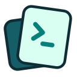

# dWarp

dWarp is a fork of [Warp](https://github.com/warpdotdev/warp), based on
[OpenWarp](https://github.com/zerx-lab/warp). It keeps the terminal, local
development tools, SSH, and integrations with external CLI agents. Warp account
login, Warp Drive, and the built-in Warp agent have been removed.



## How dWarp differs from Warp

These differences describe this fork relative to the upstream code it started
from. dWarp is maintained independently and does not follow every upstream change.

| Area | dWarp |
| --- | --- |
| Warp accounts | No Warp login, signup, account token, or subscription is needed to use the terminal. |
| Warp Drive and cloud sync | Removed, together with cloud object synchronization and the related server clients. |
| Built-in Warp agent | Removed. dWarp does not provide Warp-hosted agent execution, cloud agents, or their MCP/OAuth configuration. |
| External CLI agents | Retained. CLI agents manage their own accounts, models, and MCP servers. |
| AI command suggestions | Optional, using a provider configured under **Settings → Agents → Providers**. Provider keys use the operating system's secure storage. |
| Rendering | GPU rendering remains the default. A selectable CPU renderer is available for native builds. |
| Terminal launches | New invocations open tabs in the running application by default. `--new-window` requests another window. |
| Local development | Terminal blocks, completion, keybindings, splits, the editor, local files/workflows, code diffs, and local code review remain. |
| SSH | Retained, including local SSH configuration and remote-terminal support. |
| Build infrastructure | The local OSS build does not require Warp's private channel repository or a Warp server. |
| Identity | Application name **dWarp**, executable `dwarp`, and a distinct overlapping-terminal icon. |

External CLI agents and configured suggestion providers can make their own
network requests. Removing Warp's cloud features does not make those programs
offline. The shared-session subsystem was left outside the removal work; its
remaining source is not a promise that Warp's hosted sharing services work here.

## Rendering

GPU rendering is the default. Enable **Use CPU renderer** in settings and restart,
or launch with:

```bash
WARP_CPU_RENDERER=1 dwarp
WARP_CPU_RENDERER=1 WARP_CPU_FPS=30 dwarp
WARP_CPU_RENDERER=1 WARP_CPU_TERMINAL_FPS=10 dwarp
```

The CPU path draws the application window without a GPU rendering device. The
desktop compositor can still use the GPU. Native Windows/macOS behavior and every
Linux graphics stack are not verified by a successful Linux build.

## Watch external-tool commands in dWarp

The repository includes a wrapper for making a coding assistant's shell commands
visible in dWarp while returning output and exit status to its calling tool:

```bash
./script/run-in-dwarp --cwd /mnt/Data/Apps/warp -- cargo --version
```

This uses ordinary terminal sessions, not the removed built-in agent. It retains
private command logs, supports timeouts and cancellation, and preserves PTY
behavior. Commands reuse an owned tab and split when busy, without raising the
app. Use `--focus` when you need to answer an interactive prompt, such as sudo.
Keep the rebuilt dWarp running with an open window. It currently targets POSIX
hosts and is tested on Linux. See
[visible-command instructions](script/README-agent-terminal.md) for details.

## Build and run

```bash
./script/bootstrap
./script/run
```

The application binary is `dwarp`. The build does not require Warp's private
channel configuration repository or a Warp server.

```bash
cargo build --release --bin dwarp
cargo run --bin dwarp
```

On Linux, build and install with:

```bash
./script/build-and-install.sh
```

The installer adds the launcher, desktop entry, terminal helper, and icons, then
refreshes desktop/icon caches. It retains build logs in `logs/build-and-install/`
and removes its scratch files on success or failure. Compiled outputs and shared
Cargo caches are preserved. Restart the running app after rebuilding to load new
code and the embedded window icon.

On Windows, run `script\build-and-install.bat`. Add `-BuildOnly` to build the
installer without opening its installation wizard. See
[Windows build instructions](docs/windows-build.md) for prerequisites.

See [WARP.md](WARP.md) for development commands and code conventions.

## Uninstall

See [uninstall instructions](docs/uninstall.md) for Linux, Windows, and macOS.
Uninstall preserves user data by default. `script/uninstall.sh --purge` on
Linux/macOS or `script\uninstall.bat -Purge` on Windows also deletes current-user
data. Use the documented dry-run option to inspect the affected paths.

## License and upstream

`crates/warpui` and `crates/warpui_core` use the MIT license. The rest of this
repository uses AGPL-3.0-only. See the license files for details.

dWarp is independent of Warp, Inc. Upstream changes are reviewed and selectively
adapted to the retained local features.
